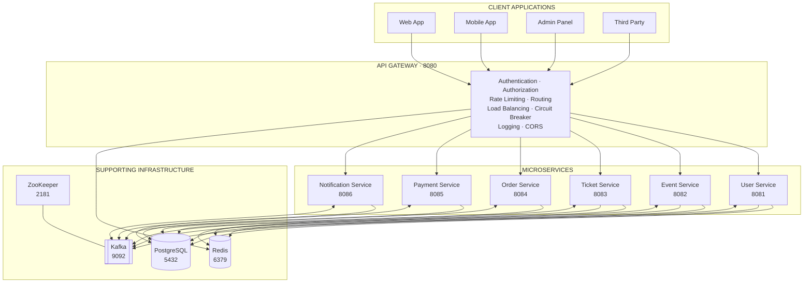

# 🎟️ Ticket Management System

  <strong>A Microservices-Based Ticket Management Platform</strong>
   
  Designed for scalability, reliability, and independent service management.

  
  
  
  

---

## 📖 Overview

The **Ticket Management System** is built using a **Microservices Architecture** consisting of 7 core services. Each service manages a specific business domain and communicates with other services through REST APIs and asynchronous messaging.

The architecture focuses on:

- **Scalability** — Scale individual services independently.
- **Fault Tolerance** — Handle service failures using circuit breakers and retry mechanisms.
- **Maintainability** — Keep business responsibilities separated.
- **Loose Coupling** — Enable communication through APIs and events.
- **Observability** — Monitor and trace requests across services.

## 🏛️ System Architecture

The system follows a layered architecture, separating client applications, API Gateway, business services, and supporting infrastructure.

### Architecture Diagram

### Architecture Layers

| Layer | Responsibility |
|---|---|
| Client Applications | Web, Mobile, Admin, and Third-Party clients |
| API Gateway | Single entry point and request management |
| Microservices | Independent business domain operations |
| Infrastructure | Database, caching, messaging, and coordination |

## ⚙️ Technology & Infrastructure

The system uses the following supporting technologies:

| Technology | Purpose |
|---|---|
| Spring Boot | Microservices application framework |
| PostgreSQL | Relational database |
| pgAdmin | Database administration |
| Redis | Caching, sessions, and distributed locking |
| Apache Kafka | Asynchronous messaging and event streaming |
| ZooKeeper | Distributed coordination for Kafka |
| Zipkin | Distributed tracing |
| Maven | Build and dependency management |
| Docker Compose | Supporting infrastructure management |

---

# 🧩 Microservices Overview

The platform consists of 7 independent services. Each service owns a specific business responsibility.

| # | Service | Port | Main Responsibility |
|---:|---|---:|---|
| 1 | API Gateway | `8080` | Entry point, routing, and security |
| 2 | User Service | `8081` | User management and authentication |
| 3 | Event Service | `8082` | Event management |
| 4 | Ticket Service | `8083` | Ticket inventory and availability |
| 5 | Order Service | `8084` | Order processing and orchestration |
| 6 | Payment Service | `8085` | Payment processing |
| 7 | Notification Service | `8086` | Notification delivery |

---

## 1. 🚪 API Gateway Service

PORT: `8080` · ENTRY POINT

**Purpose:** Provides a single entry point for all client requests and routes them to the appropriate microservices.

### Responsibilities

- **Authentication & Authorization** — Validate JWT tokens through User Service.
- **Rate Limiting** — Limit requests per client or IP using Redis.
- **Request Routing** — Forward requests to the appropriate services.
- **Load Balancing** — Distribute traffic across service instances.
- **Circuit Breaker** — Prevent cascading failures.
- **Request/Response Logging** — Centralized request logging.
- **CORS Handling** — Manage cross-origin requests.
- **API Documentation** — Integrate Swagger/OpenAPI.

### Key Components

| Component | Responsibility |
|---|---|
| `AuthenticationFilter` | JWT validation |
| `RateLimitFilter` | Redis-based rate limiting |
| `RouteConfigService` | Dynamic route configuration |
| `RedisService` | Caching and rate limiting |
| `JwtService` | Token validation delegation |

### Communication Patterns

- **Synchronous:** JWT validation with User Service.
- **Asynchronous:** Request/event logging through Kafka.
- **Caching:** Redis for rate limiting and route configurations.

---

## 2. 👤 User Service

PORT: `8081` · USER MANAGEMENT

**Purpose:** Manages user accounts, authentication, authorization, and profile information.

### Responsibilities

- User Registration — Create new user accounts.
- User Authentication — Login and logout functionality.
- JWT Token Management — Generate and validate tokens.
- User Profile Management — CRUD operations on user profiles.
- Role Management — Manage user roles and permissions.
- Password Management — Secure password handling.

### Key Components

| Component | Responsibility |
|---|---|
| `UserController` | REST endpoints for user operations |
| `UserService` | User management business logic |
| `JwtService` | JWT generation and validation |
| `UserRepository` | Database access |
| `PasswordEncoder` | Secure password encoding |

### Database Schema

**Table: `users`**

| Column | Description |
|---|---|
| `id` | Primary Key |
| `username` | Unique username |
| `email` | Unique email |
| `password` | Encrypted password |
| `first_name` | First name |
| `last_name` | Last name |
| `phone_number` | Phone number |
| `role` | USER, ADMIN |
| `created_at` | Creation timestamp |
| `updated_at` | Last update timestamp |

### Communication Patterns

- **Synchronous:** REST API calls from other services.
- **Asynchronous:** Publishes user events to Kafka.
- **Caching:** Redis for user session data.

---

## 3. 🎫 Event Service

PORT: `8082` · EVENT MANAGEMENT

**Purpose:** Manages events, event categories, availability, and event information.

### Responsibilities

- Event CRUD — Create, read, update, and delete events.
- Event Search — Search and filter events.
- Event Categories — Manage event types and categories.
- Event Status Management — Active, inactive, and cancelled events.
- Event Capacity Management — Track available seats.
- Event Analytics — Generate basic event statistics.

### Key Components

| Component | Responsibility |
|---|---|
| `EventController` | REST endpoints for event operations |
| `EventService` | Event business logic |
| `EventRepository` | Database access |
| `EventSearchService` | Search and filtering logic |

### Database Schema

**Table: `events`**

| Column | Description |
|---|---|
| `id` | Primary Key |
| `title` | Event title |
| `description` | Event description |
| `location` | Event location |
| `date` | Event date |
| `capacity` | Total capacity |
| `available_seats` | Available seats |
| `base_price` | Base ticket price |
| `event_type` | CONCERT, SPORTS, THEATER, etc. |
| `status` | ACTIVE, INACTIVE, CANCELLED |
| `created_at` | Creation timestamp |
| `updated_at` | Last update timestamp |

### Communication Patterns

- **Synchronous:** REST API calls from other services.
- **Asynchronous:** Publishes event updates to Kafka.
- **Caching:** Redis for event listings and search results.

---

## 4. 🎟️ Ticket Service

PORT: `8083` · INVENTORY MANAGEMENT

**Purpose:** Manages ticket inventory, seat assignments, availability, and temporary ticket reservations.

### Responsibilities

- Ticket Inventory — Manage ticket availability.
- Seat Management — Handle seat assignments and conflicts.
- Ticket Locking — Temporarily hold tickets during purchases.
- Ticket Status Management — Available, locked, sold, and cancelled.
- Expired Lock Cleanup — Automatically clean expired locks.
- Ticket Analytics — Track ticket availability statistics.

### Key Components

| Component | Responsibility |
|---|---|
| `TicketController` | REST endpoints for ticket operations |
| `TicketService` | Ticket business logic |
| `TicketRepository` | Database access |
| `ScheduledTasks` | Cleanup expired locks |
| `RedisService` | Distributed locking |

### Database Schema

**Table: `tickets`**

| Column | Description |
|---|---|
| `id` | Primary Key |
| `event_id` | Event reference |
| `seat_number` | Seat number |
| `price` | Ticket price |
| `ticket_type` | VIP, STANDARD, etc. |
| `status` | AVAILABLE, LOCKED, SOLD, CANCELLED |
| `locked_until` | Lock expiration time |
| `locked_by` | User ID holding the ticket |
| `created_at` | Creation timestamp |
| `updated_at` | Last update timestamp |

### Communication Patterns

- **Synchronous:** REST API calls from Order Service.
- **Asynchronous:** Publishes ticket status changes to Kafka.
- **Distributed Locking:** Redis for ticket locking.
- **Scheduled Tasks:** Cleanup expired locks.

---

## 5. 🛒 Order Service

PORT: `8084` · ORDER PROCESSING

**Purpose:** Handles order creation and coordinates the purchasing process across multiple services.

### Responsibilities

- Order Creation — Create new orders.
- Order Orchestration — Coordinate operations between services.
- Order Status Management — Track order lifecycle.
- Payment Integration — Coordinate with Payment Service.
- Ticket Reservation — Lock tickets during the order process.
- Order Cancellation — Handle cancellations and refunds.
- Order History — Provide user order history and tracking.

### Key Components

| Component | Responsibility |
|---|---|
| `OrderController` | REST endpoints for order operations |
| `OrderService` | Order business logic |
| `OrderEventService` | Asynchronous event publishing |
| `UserServiceClient` | Feign client for User Service |
| `TicketServiceClient` | Feign client for Ticket Service |
| `PaymentServiceClient` | Feign client for Payment Service |

### Database Schema

**Table: `orders`**

| Column | Description |
|---|---|
| `id` | Primary Key |
| `user_id` | User reference |
| `ticket_id` | Ticket reference |
| `event_id` | Event reference |
| `status` | PENDING, CONFIRMED, CANCELLED, FAILED |
| `total_amount` | Total order amount |
| `quantity` | Ticket quantity |
| `payment_id` | Payment reference |
| `order_date` | Order date |
| `created_at` | Creation timestamp |
| `updated_at` | Last update timestamp |

### Communication Patterns

- **Synchronous:** REST calls to User, Ticket, and Payment Services.
- **Asynchronous:** Publishes order events to Kafka.
- **Circuit Breaker:** Resilience4j for external service calls.
- **Retry Logic:** Automatic retry for failed operations.

---

## 6. 💳 Payment Service

PORT: `8085` · PAYMENT PROCESSING

**Purpose:** Handles payment processing, payment status tracking, refunds, and payment gateway integrations.

### Responsibilities

- Payment Processing — Handle different payment methods.
- Payment Gateway Integration — Integrate multiple payment gateways.
- Payment Status Tracking — Track payment lifecycle.
- Refund Processing — Handle payment refunds.
- Payment Analytics — Payment statistics and reporting.
- Fraud Detection — Basic fraud prevention.

### Key Components

| Component | Responsibility |
|---|---|
| `PaymentController` | REST endpoints for payment operations |
| `PaymentService` | Payment business logic |
| `PaymentGatewayService` | Payment gateway integration |
| `PaymentRepository` | Database access |
| `FraudDetectionService` | Basic fraud prevention |

### Database Schema

**Table: `payments`**

| Column | Description |
|---|---|
| `id` | Primary Key |
| `order_id` | Order reference |
| `user_id` | User reference |
| `amount` | Payment amount |
| `currency` | Currency |
| `payment_method` | CREDIT_CARD, DEBIT_CARD, etc. |
| `status` | PENDING, COMPLETED, FAILED, REFUNDED |
| `gateway_transaction_id` | Gateway transaction ID |
| `gateway_response` | Gateway response |
| `payment_date` | Payment date |
| `created_at` | Creation timestamp |
| `updated_at` | Last update timestamp |

### Communication Patterns

- **Synchronous:** REST API calls from Order Service.
- **Asynchronous:** Publishes payment events to Kafka.
- **External APIs:** Payment gateway integrations.
- **Circuit Breaker:** Handles payment gateway failures.

---

## 7. 🔔 Notification Service

PORT: `8086` · NOTIFICATION DELIVERY

**Purpose:** Handles notification delivery and notification history across the platform.

### Responsibilities

- Email Notifications — Send email notifications.
- SMS Notifications — Send SMS notifications.
- Push Notifications — Send mobile push notifications.
- Notification Templates — Manage notification templates.
- Notification History — Track sent notifications.
- Retry Logic — Handle failed notifications.
- Notification Preferences — Manage user notification settings.

### Key Components

| Component | Responsibility |
|---|---|
| `NotificationController` | REST endpoints for notification operations |
| `NotificationService` | Notification business logic |
| `EmailService` | Email delivery |
| `SmsService` | SMS delivery |
| `KafkaListener` | Consume Kafka notification events |
| `NotificationRepository` | Database access |

### Database Schema

**Table: `notifications`**

| Column | Description |
|---|---|
| `id` | Primary Key |
| `user_id` | User reference |
| `order_id` | Order reference |
| `type` | EMAIL, SMS, PUSH |
| `subject` | Notification subject |
| `content` | Notification content |
| `status` | PENDING, SENT, FAILED |
| `retry_count` | Number of retries |
| `sent_at` | Sent timestamp |
| `created_at` | Creation timestamp |
| `updated_at` | Last update timestamp |

### Communication Patterns

- **Asynchronous:** Consumes events from Kafka.
- **External APIs:** Email and SMS integrations.
- **Retry Logic:** Handles delivery failures.
- **Batch Processing:** Processes notifications in batches.

---

# 🔄 Service Communication

The system uses multiple communication patterns depending on the operation and business requirement.

## 1. Synchronous Communication — REST APIs

**Pattern:** Request–Response

Used for operations that require an immediate response.

| Service Communication | Purpose |
|---|---|
| API Gateway ↔ User Service | JWT validation |
| Order Service ↔ User Service | User validation |
| Order Service ↔ Ticket Service | Ticket operations |
| Order Service ↔ Payment Service | Payment processing |

## 2. Asynchronous Communication — Kafka

**Pattern:** Event-Driven Architecture

Used for non-blocking operations, notifications, and analytics.

### Event Topics

| Kafka Topic | Description |
|---|---|
| `order-created` | A new order has been created |
| `order-confirmed` | Order payment has been confirmed |
| `order-cancelled` | An order has been cancelled |
| `payment-processed` | Payment has been completed |
| `ticket-locked` | Tickets have been locked |
| `ticket-sold` | Tickets have been sold |
| `user-registered` | A new user has registered |

## 3. Caching Communication — Redis

**Pattern:** Cache-Aside

Used for frequently accessed data and session management.

| Cached Data | Purpose |
|---|---|
| User Sessions | JWT tokens and user information |
| Event Data | Event listings and search results |
| Ticket Availability | Available ticket counts |
| Rate Limiting | Request counts per client |
| Route Configuration | API Gateway route configurations |

## 4. Database Communication

**Pattern:** Repository Pattern

Used for data persistence and transaction management.

### Database Patterns

- **Shared Database:** All services use the same PostgreSQL instance.
- **Repository Pattern:** Abstract database access.
- **Transaction Management:** ACID compliance.
- **Connection Pooling:** HikariCP for database connection performance.

---

# 🔐 Security Architecture

Security is implemented across the platform to protect user accounts, APIs, and internal service communication.

## Authentication & Authorization

| Security Component | Purpose |
|---|---|
| JWT Tokens | Stateless authentication |
| Role-Based Access Control | User roles and permissions |
| API Gateway Security | Centralized security enforcement |
| Service-to-Service Security | Internal network security |

## Rate Limiting

The system uses Redis-based rate limiting to control incoming API traffic.

- **Per Client/IP:** Apply individual client limits.
- **Per Endpoint:** Configure different limits for different APIs.
- **Sliding Window:** Time-based rate limiting.
- **Redis Storage:** Share rate limit data across instances.

---

# 📈 Scalability & Resilience

## 1. Horizontal Scaling

The architecture supports independent scaling of services.

- **Service Replication:** Run multiple instances of each service.
- **Load Balancing:** Distribute traffic across service instances.
- **Auto-scaling:** Scale based on system metrics.
- **Database Scaling:** Read replicas and sharding.

## 2. Caching Strategy

The system uses multiple caching layers to improve performance.

| Caching Layer | Purpose |
|---|---|
| Application Cache | In-memory application caching |
| Distributed Cache | Redis for shared data |
| Database Cache | Query result caching |
| CDN Cache | Static content caching |

## 3. Circuit Breaker Pattern

**Implementation:** Resilience4j

| Mechanism | Purpose |
|---|---|
| Failure Threshold | Configure failure limits |
| Timeout | Control waiting time and recovery attempts |
| Fallback | Provide graceful degradation |
| Circuit Breaker | Prevent cascading failures |

---

# 🔍 Monitoring & Observability

Monitoring and observability help track application health, performance, and requests across multiple services.

## 1. Health Checks

The system exposes Spring Boot Actuator health endpoints.

| Endpoint | Purpose |
|---|---|
| `/actuator/health` | Overall application health |
| `/actuator/health/db` | Database connectivity |
| `/actuator/health/redis` | Redis connectivity |
| `/actuator/health/kafka` | Kafka connectivity |

## 2. Metrics Collection

The architecture tracks several types of metrics:

- **Application Metrics:** Request rates and response times.
- **Business Metrics:** Orders, payments, and tickets.
- **Infrastructure Metrics:** CPU, memory, and disk usage.
- **Custom Metrics:** Business-specific KPIs.

## 3. Distributed Tracing

**Tools:** Sleuth and Zipkin

| Component | Purpose |
|---|---|
| Sleuth | Distributed tracing |
| Zipkin | Trace visualization |
| Trace IDs | Correlate requests across services |
| Span Tracking | Track operation timing |

---

# 🚀 Deployment Architecture

The architecture supports containerized deployment and multiple environments.

## 1. Container Orchestration

| Technology | Purpose |
|---|---|
| Docker Containers | Application service packaging |
| Kubernetes | Container orchestration |
| Istio | Service mesh and advanced networking |
| CI/CD | Automated deployment pipelines |

## 2. Environment Strategy

| Environment | Deployment Strategy |
|---|---|
| Development | Local Docker Compose |
| Staging | Production-like environment |
| Production | High-availability setup |

---

# 🔗 Service Dependencies

## 1. Infrastructure Dependencies

| Service | Database | Redis | Kafka | External APIs |
|---|:---:|:---:|:---:|:---:|
| API Gateway | ✅ | ✅ | ✅ | ✅ |
| User Service | ✅ | ✅ | ✅ | ❌ |
| Event Service | ✅ | ✅ | ✅ | ❌ |
| Ticket Service | ✅ | ✅ | ✅ | ❌ |
| Order Service | ✅ | ✅ | ✅ | ✅ |
| Payment Service | ✅ | ✅ | ✅ | ✅ |
| Notification Service | ✅ | ✅ | ✅ | ✅ |

## 2. Service Dependencies

| Service | Depends On | Communication |
|---|---|---|
| API Gateway | User Service | Synchronous (JWT validation) |
| Order Service | User, Ticket, Payment Services | Synchronous (REST) |
| Notification Service | All Services | Asynchronous (Kafka) |
| Payment Service | Order Service | Synchronous (REST) |

---

# 🎯 Key Design Principles

The architecture follows these core software design principles:

| Principle | Description |
|---|---|
| **Single Responsibility** | Each service has one well-defined business responsibility. |
| **Loose Coupling** | Services communicate through APIs and events rather than direct dependencies. |
| **High Cohesion** | Related functionality stays within its business domain. |
| **Fault Tolerance** | Services handle failures through circuit breakers and fallbacks. |
| **Scalability** | Services can scale independently based on demand. |
| **Observability** | Centralized monitoring, logging, and distributed tracing. |
| **Security** | Multiple security layers with authentication and authorization. |

---

# 📌 Conclusion

The **Ticket Management System** provides a microservices-based foundation for managing users, events, tickets, orders, payments, and notifications.

By separating business responsibilities into 7 independent services and using PostgreSQL, Redis, Kafka, and supporting infrastructure, the architecture is designed to support:

- Independent service development and deployment.
- Scalable business operations.
- Asynchronous event-driven communication.
- Reliable order and payment processing.
- Centralized API access and security.
- Monitoring and tracing across services.

**The goal is to build a scalable, maintainable, and reliable Ticket Management Platform using Spring Boot Microservices.**