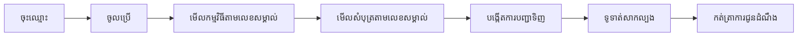

# របៀបប្រើប្រព័ន្ធគ្រប់គ្រងសំបុត្រ

## ១. គោលបំណង

ប្រព័ន្ធនេះជាផ្នែកខាងក្រោយសម្រាប់គ្រប់គ្រងអ្នកប្រើ កម្មវិធី សំបុត្រ ការបញ្ជាទិញ ការទូទាត់ និងការជូនដំណឹង។ វាបែងចែកជាសេវាតូចៗ ដូច្នេះងាយថែទាំ និងពង្រីក។ បច្ចុប្បន្នមិនទាន់មានគេហទំព័រ ឬកម្មវិធីទូរសព្ទសម្រាប់ចុចប្រើទេ។ អ្នកអាចសាកល្បងតាមផ្ទាំងសាកល្បង API ឬពាក្យបញ្ជា `curl`។

> **ចំណាំសំខាន់៖** ការទូទាត់ អ៊ីមែល និងសារខ្លីនៅក្នុងកំណែនេះជាការក្លែងសាកល្បងប៉ុណ្ណោះ មិនទាន់ភ្ជាប់ធនាគារ បាគង កាតពិត ឬក្រុមហ៊ុនទូរសព្ទនៅកម្ពុជាទេ។

## ២. តម្រូវការម៉ាស៊ីន

- ចាវ៉ា ជំនាន់ ២១
- ម៉ាវិន ជំនាន់ ៣.៩ ឬថ្មីជាងនេះ
- ដុកឃើរ និងមុខងារ ដុកឃើរ ខមផូស
- `curl` ឬកម្មវិធីសាកល្បង API

ពិនិត្យជំនាន់៖

```bash
java -version
mvn -version
docker --version
```

## ៣. ដំឡើង និងបើកប្រព័ន្ធ

១. បើក PostgreSQL, Redis, Kafka និង Zipkin ពីថតដើមគម្រោង៖

```bash
docker compose -f deployment/infrastructure/docker-compose.yml up -d
docker compose -f deployment/infrastructure/docker-compose.yml ps
```

២. សាងសង់គម្រោង៖

```bash
mvn clean install -DskipTests
```

៣. បើកពាក្យបញ្ជាថ្មីចំនួន ៧ ហើយដំណើរការមួយបន្ទាត់ក្នុងមួយផ្ទាំង៖

```bash
mvn -pl user-service -am spring-boot:run
mvn -pl api-gateway -am spring-boot:run
mvn -pl event-service -am spring-boot:run
mvn -pl ticket-service -am spring-boot:run
mvn -pl order-service -am spring-boot:run
mvn -pl payment-service -am spring-boot:run
mvn -pl notification-service -am spring-boot:run
```

៤. ច្រកសេវាគឺ៖ ច្រកកណ្ដាល `8080` អ្នកប្រើ `8081` កម្មវិធី `8082` សំបុត្រ `8083` បញ្ជាទិញ `8084` ទូទាត់ `8085` និងជូនដំណឹង `8086`។ ផ្ទាំងសាកល្បងមាននៅ `http://localhost:លេខច្រក/swagger-ui/index.html`។

គណនីមូលដ្ឋានទិន្នន័យសម្រាប់ការអភិវឌ្ឍគឺ `ticketuser` ពាក្យសម្ងាត់ `ticketpass` និងឈ្មោះមូលដ្ឋានទិន្នន័យ `ticketdb`។ ផ្ទាំងគ្រប់គ្រងមូលដ្ឋានទិន្នន័យនៅ `http://localhost:5050` ប្រើ `sembunly2005@gmail.com` និងពាក្យសម្ងាត់ `0000`។ កុំប្រើព័ត៌មានទាំងនេះលើប្រព័ន្ធពិត។

## ៤. លំហូររបស់អ្នកប្រើ



### ៤.១ ចុះឈ្មោះ

ឧទាហរណ៍បង្កើតគណនីសម្រាប់អ្នកប្រើនៅភ្នំពេញ៖

```bash
curl -X POST http://localhost:8081/api/public/users/registration -H "Content-Type: application/json" -d "{\"username\":\"sokha\",\"password\":\"Sokha123!\",\"email\":\"sokha@example.com\",\"first_name\":\"សុខា\",\"last_name\":\"ចាន់\"}"
```

បើមិនផ្ញើ `roles` ប្រព័ន្ធនឹងផ្តល់តួនាទី `USER` ដោយស្វ័យប្រវត្តិ។

### ៤.២ ចូលប្រើ

```bash
curl -X POST http://localhost:8081/api/public/users/login -H "Content-Type: application/json" -d "{\"username\":\"sokha\",\"password\":\"Sokha123!\"}"
```

ចម្លងតម្លៃ `data.access_token` ពីចម្លើយ។ សម្រាប់ផ្លូវដែលការពារ ត្រូវបន្ថែមក្បាលសំណើ៖

```http
Authorization: Bearer <access_token>
```

### ៤.៣ មើលកម្មវិធី និងសំបុត្រ

កំណែនេះមិនទាន់មានផ្លូវបង្ហាញបញ្ជី ឬស្វែងរកកម្មវិធីទេ។ អ្នកអាចមើលតែតាមលេខសម្គាល់ដែលអ្នកគ្រប់គ្រងបានបង្កើត៖

```bash
curl http://localhost:8082/api/v1/events/1
curl http://localhost:8083/api/v1/tickets/1
```

### ៤.៤ កក់សំបុត្រ និងទូទាត់

ផ្ញើសញ្ញាសម្ងាត់ពេលបង្កើតការបញ្ជាទិញ៖

```bash
curl -X POST http://localhost:8084/api/v1/orders -H "Content-Type: application/json" -H "Authorization: Bearer <access_token>" -d "{\"eventId\":1,\"ticketId\":1,\"quantity\":2,\"amount\":20.00}"
```

ឧទាហរណ៍នេះមានន័យថា កក់ ២ សំបុត្រសម្រាប់កម្មវិធីនៅកោះពេជ្រ តម្លៃសរុប ២០ ដុល្លារ។ សេវាបញ្ជាទិញនឹងហៅការទូទាត់ជាប្រាក់ដុល្លារ និងវិធី `CREDIT_CARD` ដោយស្វ័យប្រវត្តិ។ បច្ចុប្បន្នវាមិនពិនិត្យកម្មវិធី ឬសំបុត្រជាមួយសេវាពាក់ព័ន្ធ ហើយមិនកាត់ប្រាក់ពិតទេ។

មើលការបញ្ជាទិញ៖

```bash
curl http://localhost:8084/api/v1/orders/1
```

បោះបង់ការបញ្ជាទិញ៖

```bash
curl -X POST http://localhost:8084/api/v1/orders/1 -H "Authorization: Bearer <access_token>"
```

### ៤.៥ ទទួលការជូនដំណឹង

ពេលការបញ្ជាទិញជោគជ័យ សេវាបញ្ជាទិញផ្ញើព្រឹត្តិការណ៍តាម Kafka ហើយសេវាជូនដំណឹងកត់ត្រាលទ្ធផលអ៊ីមែល និងសារខ្លី។ បច្ចុប្បន្ន អាសយដ្ឋានអ៊ីមែល និងលេខទូរសព្ទត្រូវបានកំណត់ថេរក្នុងកូដ មិនទាន់យកពីគណនីអ្នកប្រើទេ។ សារត្រូវបានសរសេរចូលកំណត់ហេតុម៉ាស៊ីន មិនបានផ្ញើទៅទូរសព្ទពិតឡើយ។

## ៥. សម្រាប់អ្នកគ្រប់គ្រង

ប្រព័ន្ធបង្កើតតួនាទី `USER` និង `ADMIN` ពេលសេវាអ្នកប្រើចាប់ផ្តើម ប៉ុន្តែមិនបង្កើតគណនីអ្នកគ្រប់គ្រងជាមុនទេ។ សម្រាប់បរិស្ថានសាកល្បង អាចចុះឈ្មោះដោយផ្ញើ `"roles":["ADMIN"]` ហើយចូលប្រើដើម្បីទទួលសញ្ញាសម្ងាត់។ ការអនុញ្ញាតតួនាទីនៅផ្នែកខ្លះមិនទាន់តឹងរឹង ដូច្នេះកុំបើកប្រព័ន្ធនេះជាសាធារណៈ។

អ្នកគ្រប់គ្រងអាចប្រើផ្ទាំងសាកល្បង API ដើម្បី៖

- គ្រប់គ្រងអ្នកប្រើនៅ `/api/users`
- បង្កើត កែ និងលុបតួនាទីនៅ `/api/roles`
- គ្រប់គ្រងក្រុមនៅ `/api/groups` និងសិទ្ធិនៅ `/api/permissions`
- បង្កើត កែ មើល និងលុបកម្មវិធីនៅ `/api/v1/events`
- បង្កើត និងមើលសំបុត្រនៅ `/api/v1/tickets`

ឧទាហរណ៍បង្កើតការប្រគំតន្ត្រីនៅកោះពេជ្រ៖

```bash
curl -X POST http://localhost:8082/api/v1/events -H "Content-Type: application/json" -d "{\"title\":\"ការប្រគំតន្ត្រីខ្មែរ\",\"description\":\"កម្មវិធីសម្រាប់គ្រួសារ\",\"location\":\"កោះពេជ្រ ភ្នំពេញ\",\"eventDate\":\"2026-12-10T18:00:00\",\"basePrice\":10.00,\"capacity\":500,\"eventType\":\"CONCERT\",\"status\":\"UPCOMING\"}"
```

ចំណាំ៖ ពេលបង្កើត កូដបច្ចុប្បន្នកំណត់ថ្ងៃកម្មវិធីទៅពេលបច្ចុប្បន្នជំនួស `eventDate` ដែលបានផ្ញើ។ អាចកែថ្ងៃវិញតាម `PUT /api/v1/events/{id}`។

ឧទាហរណ៍បង្កើតសំបុត្រធម្មតា៖

```bash
curl -X POST http://localhost:8083/api/v1/tickets -H "Content-Type: application/json" -d "{\"eventId\":1,\"seatNumber\":\"A-01\",\"price\":10.00,\"ticketType\":\"STANDARD\",\"ticketStatus\":\"AVAILABLE\"}"
```

## ៦. បញ្ហាញឹកញាប់

| បញ្ហា | ដំណោះស្រាយ |
|---|---|
| មិនអាចភ្ជាប់មូលដ្ឋានទិន្នន័យ | រត់ `docker compose -f deployment/infrastructure/docker-compose.yml ps` ហើយពិនិត្យថា PostgreSQL មានស្ថានភាពល្អ |
| ច្រកត្រូវបានប្រើរួច | បិទកម្មវិធីដែលកាន់ច្រក `8080` ដល់ `8086`, `5432`, `6379` ឬ `9092` |
| ចូលប្រើមិនបាន | ចុះឈ្មោះជាមុន ពិនិត្យឈ្មោះ និងពាក្យសម្ងាត់ ហើយមើលកំណត់ហេតុសេវាអ្នកប្រើ |
| ទទួលលេខកូដ `401` | ផ្ញើ `Authorization: Bearer <access_token>` និងចូលប្រើម្ដងទៀតបើសញ្ញាសម្ងាត់ផុតកំណត់ |
| ច្រកកណ្ដាលឆ្លើយ `404` | ផ្លូវកំណត់ជាមុនមានតែសេវាអ្នកប្រើ។ សម្រាប់សេវាផ្សេង ត្រូវប្រើច្រក `8082` ដល់ `8086` ដោយផ្ទាល់ |
| Kafka មិនដំណើរការ | ពិនិត្យ `docker compose -f deployment/infrastructure/docker-compose.yml logs kafka` និងបើក Kafka មុនសេវាបញ្ជាទិញ/ជូនដំណឹង |
| មិនទទួលអ៊ីមែល ឬសារខ្លីពិត | នេះជាឥរិយាបថធម្មតានៃកំណែសាកល្បង; ពិនិត្យកំណត់ហេតុរបស់សេវាជូនដំណឹង |
| រកមិនឃើញបញ្ជីកម្មវិធី | មុខងារបញ្ជី និងស្វែងរកមិនទាន់បានអនុវត្ត; ប្រើលេខសម្គាល់កម្មវិធីដោយផ្ទាល់ |

បិទសេវាចាវ៉ាដោយចុច `Ctrl+C` ក្នុងផ្ទាំងនីមួយៗ។ បិទហេដ្ឋារចនាសម្ព័ន្ធដោយ៖

```bash
docker compose -f deployment/infrastructure/docker-compose.yml down
```

កុំនៅប្រើ `down -v` លុះត្រាតែចង់លុបទិន្នន័យមូលដ្ឋានទាំងអស់។
